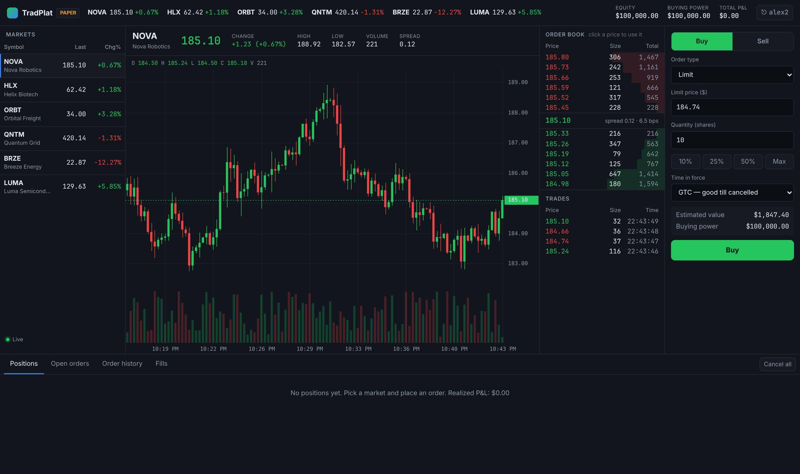

# TradPlat

A paper-trading platform with a real matching engine, simulated liquidity, and a live
browser trading terminal. Every account starts with **$100,000 of simulated cash**.
All instruments and market data are fictional and simulated.



## Quick start

```bash
npm start            # http://localhost:3000  (PORT=8080 npm start to change)
npm test             # engine + HTTP API tests
```

Requires Node 18+. There are no npm dependencies.

## Features

**Exchange engine** (`src/engine/`)
- Limit order book per symbol with **price-time priority**
- Order types: **limit**, **market**, **stop** (stop-market) and **stop-limit**
- Time in force: **GTC** and **IOC**
- Fills at the resting (maker) price, so aggressive limits get price improvement
- **Pre-trade risk checks**: cash and shares are reserved when an order is accepted, so the
  same balance can't back two orders. Market buys are capped by buying power. No short selling.
- **Self-trade prevention** (cancels the older resting order)
- Position tracking with average cost, realized and unrealized P&L
- OHLCV candle aggregation from trades
- Integer cents and whole shares throughout, so there are no floating-point money errors

**Market simulation**
- A market maker quotes a 10-level ladder per symbol around a random-walk fair value
- The fair value is pulled toward the last trade, so your orders can move the market
- Noise traders send market orders to create a live tape and candles

**Trading terminal** (`public/`)
- Live watchlist and ticker tape, candlestick and volume chart with crosshair and OHLC readout
- Your open orders appear as lines on the chart and are marked in the book
- Depth-of-book with cumulative size bars. Click a level to use its price.
- Order ticket with estimated value, buying power and 10/25/50/Max sizing
- Tabs for positions (with one-click close), open orders, order history and fills
- Fill notifications. Keyboard shortcuts: `b` for buy, `s` for sell.
- Pushed over Server-Sent Events about every 400 ms
- Works on phone-sized screens

## API

All prices are **integer cents**. Authenticated routes take `Authorization: Bearer <token>`.

| Method | Path | Description |
| --- | --- | --- |
| POST | `/api/auth/register` | `{username, password}` → `{token, account}` |
| POST | `/api/auth/login` | `{username, password}` → `{token, account}` |
| POST | `/api/auth/logout` | Invalidate the token |
| GET | `/api/symbols` | Tickers for all symbols |
| GET | `/api/markets/:symbol` | Ticker |
| GET | `/api/markets/:symbol/book?depth=14` | Aggregated depth |
| GET | `/api/markets/:symbol/candles` | OHLCV history (15 s candles) |
| GET | `/api/markets/:symbol/trades` | Recent trades |
| GET | `/api/account` 🔒 | Balances, positions, orders, fills |
| POST | `/api/orders` 🔒 | Place an order (see below) |
| DELETE | `/api/orders/:id` 🔒 | Cancel one order |
| DELETE | `/api/orders?symbol=` 🔒 | Cancel all orders, optionally for one symbol |
| GET | `/api/stream?token=` | SSE stream with `market` and `account` events |

Order body:

```json
{ "symbol": "NOVA", "side": "buy", "type": "limit", "price": 18450, "qty": 10, "tif": "GTC" }
```

`type` is one of `limit`, `market`, `stop` or `stop_limit`. Stop orders need `stopPrice`.
Orders that fail risk checks return `422` with `status: "rejected"` and a `reason`.

```bash
TOKEN=$(curl -s localhost:3000/api/auth/register -H 'Content-Type: application/json' \
  -d '{"username":"bot1","password":"secret123"}' | node -pe 'JSON.parse(require("fs").readFileSync(0)).token')
curl -s localhost:3000/api/orders -H "Authorization: Bearer $TOKEN" -H 'Content-Type: application/json' \
  -d '{"symbol":"NOVA","side":"buy","type":"market","qty":10}'
```

## Project layout

```
src/
  config.js            symbols and starting cash
  server.js            HTTP API, auth, SSE streaming, static files
  engine/
    OrderBook.js       sorted bid/ask book, depth aggregation
    Exchange.js        accounts, risk, matching, settlement, stops, candles
    Simulator.js       market maker and noise traders, history seeding
public/                trading terminal (vanilla JS, canvas chart)
test/                  node:test suites
```

## Limitations

This is a paper-trading simulator, not a brokerage:
- State is **in memory**. Restarting the server resets all accounts and markets.
- Passwords are hashed with scrypt, but there is no rate limiting, HTTPS or session expiry.
  Put it behind a TLS proxy before exposing it beyond localhost.
- There is one process and no persistence layer. The engine is synchronous and deterministic,
  so it would be straightforward to put an event log or database behind it.
